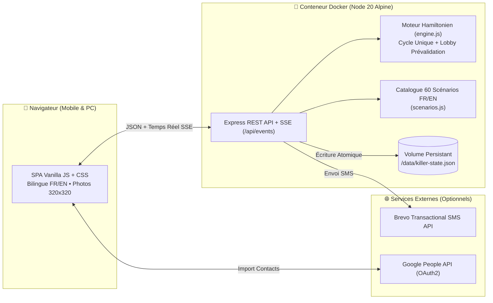

# 🎯 Le Cercle des Assassins — Jeu du Killer Grandeur Nature

Une application web complète, **bilingue (🇫🇷 Français / 🇬🇧 English)**, illustrée et pensée pour smartphone, permettant d'organiser et d'animer un **Jeu du Killer (Cercle des Assassins)** lors d'une soirée, d'un week-end ou d'un événement.

---

## ✨ Fonctionnalités Principales

### 👥 1. Phase de Prévalidation & Invitations (Avant-Soirée)
- **Salon de Prévalidation (`mode: lobby`)** : Saisissez ou importez tous les invités potentiels avant la soirée et envoyez-leur leur lien personnel unique (`/p/<token>`) par SMS ou WhatsApp.
- **Validation par chaque invité** : En ouvrant son lien sur son smartphone, chaque invité peut :
  1. Choisir sa langue (**🇫🇷 Français** ou **🇬🇧 English**),
  2. Confirmer ou décliner sa participation (**« ✅ Oui, je participe ! »** / **« ❌ Non, je ne joue pas »**),
  3. Prendre un **Selfie / Photo de profil** (redimensionné et compressé automatiquement côté navigateur en `320x320`) ou choisir parmi **8 portraits d'agents secrets illustrés par défaut**,
  4. Lire les **règles illustrées** et voir en direct la galerie des autres participants confirmés.
- **Lancement filtré en 1 clic** : Au début de la soirée, le Maître du Jeu clique sur *« 🚀 Lancer le Cercle des Assassins »* : l'algorithme génère la boucle fermée et attribue les scénarios **uniquement aux participants confirmés**, tout en conservant leurs liens personnels déjà envoyés, leurs photos et leur langue.

### 🕵️ 2. Interface Joueur (« Mon Contrat Secret »)
- **Accès instantané** par lien magique personnel (`/p/<token>`) ou via Prénom + Code PIN à 4 chiffres.
- **Écran Anti-Espion (Camouflage)** : Par défaut, la cible et la mission sont floutées ; le joueur touche *« 👁️ Révéler ma Cible & Mission »* quand personne ne regarde son écran.
- **Affichage visuel de la Cible** : Photo/selfie de la cible dans un viseur animé + intitulé, catégorie, niveau de difficulté et astuce du **Scénario de Meurtre**.
- **Validation de meurtre & Héritage automatique** :
  - Par **Code d'Autopsie (PIN à 4 chiffres)** donné par la victime, ou validation directe en 1 clic (configurable par le MJ), ou bouton *« 💀 J'ai été éliminé(e) »* côté victime.
  - Dès le meurtre validé, le chasseur **hérite instantanément de la Cible et du Scénario de sa victime** pour refermer la boucle sans jamais créer de sous-boucle isolée.
- **Tableau de chasse illustré** : Historique des précédents meurtres du joueur avec l'heure, la mission accomplie et la photo de chaque victime.

### 🛡️ 3. Règle de Contre-Attaque Configurable
Lors de la création (ou en cours de partie), le Maître du Jeu choisit la règle applicable lorsqu'une cible démasque son chasseur en devinant sa mission à voix haute :
- **Option A (Classique)** : La mission de l'assassin est grillée ; il reçoit automatiquement un nouveau scénario sur la même cible.
- **Option B1 (Immunité)** : La cible obtient **15 minutes d'immunité** et l'assassin reçoit un nouveau scénario.
- **Option B2 (Mortelle)** : L'assassin démasqué est immédiatement éliminé (son propre chasseur récupère sa cible).
- **Aucune** : Règle de contre-attaque désactivée.

### 👑 4. Poste de Commandement Maître du Jeu (`/admin`)
- **Vue globale de la boucle en temps réel (SSE)** : Schéma de la chaîne circulaire `Joueur A ➔ Joueur B ➔ Joueur C ➔ 🔄 Joueur A` avec photos et duos visuels `🕵️ Chasseur ➔ 🎯 Cible`.
- **Remplacement de scénario à la volée** :
  - 🎲 Tirer un nouveau scénario aléatoire en 1 clic,
  - 📚 Choisir un scénario précis parmi le catalogue bilingue de **60 scénarios**,
  - ✍️ Rédiger un scénario sur-mesure (FR/EN) pour un joueur.
- **Arbitrage complet** : Validation forcée d'un kill, bouton **⏪ Annuler le dernier meurtre (Undo)** avec restauration de la boucle, et **➕ Insertion d'un joueur retardataire** en cours de partie sans casser le cycle.
- **Communication Multi-Canal** :
  - 🥇 **API SMS Externe (Brevo SMS, Octopush, OVH, Twilio, Free Mobile, Webhook)** avec vérificateur de solde et **testeur d'envoi SMS en direct**.
  - 💬 **WhatsApp Web / Desktop en 1 clic** (`wa.me` pré-rempli dans la langue du joueur).
  - 📱 **SMS local depuis PC / Smartphone** (`sms:` URI + générateur de QR Code).
- **Intégration Google Contacts** :
  - Synchronisation directe via **Google People API (OAuth 2.0)**,
  - Import de fichiers **Google Contacts `.csv` ou vCard `.vcf`**,
  - Sélecteur de contacts natif sur smartphone (*Contact Picker API*).

---

## 🏗️ Architecture Technique



---

## 🚀 Installation & Démarrage Rapide

### Option A — Déploiement avec Docker Compose (Recommandé)

1. **Cloner le dépôt et créer le fichier `.env`** :
   ```bash
   git clone https://github.com/micknvb/killer-cercle-assassins.git
   cd killer-cercle-assassins
   cp .env.example .env
   ```
2. **Éditer `.env`** avec votre mot de passe Maître du Jeu et votre nom de domaine :
   ```env
   ADMIN_PASSWORD=VotreMotDePasseSecretMJ
   PUBLIC_URL=https://killer.votre-domaine.fr
   PORT=3000
   ```
3. **Lancer le script de build, tests automatisés et déploiement** :
   ```bash
   chmod +x deploy.sh
   ./deploy.sh
   ```
   *(Note : si vous n'utilisez pas un réseau externe `caddy_net`, supprimez ou commentez la section `networks` dans `docker-compose.yml`).*

### Option B — Exécution locale (Node.js >= 20)

```bash
cd app
npm install
npm test
ADMIN_PASSWORD="admin" PUBLIC_URL="http://localhost:3000" npm start
```
- Interface publique & Joueurs : `http://localhost:3000`
- Interface Maître du Jeu : `http://localhost:3000/admin`

---

## 🧪 Tests Automatisés

Le projet inclut une suite de tests de bout-en-bout (`node:test`) qui vérifie :
1. L'intégrité du catalogue bilingue (FR/EN) des 60 scénarios de meurtre,
2. La normalisation des numéros de téléphone et la génération des portraits SVG par défaut,
3. La garantie mathématique du cycle hamiltonien unique (`verifySingleCycle`),
4. Le cycle complet d'une partie (onboarding photo/langue, remplacement de scénario, contre-attaque, élimination, héritage de cible et annulation/undo),
5. Le workflow complet du **Salon de Prévalidation (`mode: lobby`)** (invitations, réponses Oui/Non, upload photo et lancement filtré).

```bash
cd app && npm test
```

---

## 📄 Licence

Distribué sous licence **MIT**. Voir le fichier [LICENSE](LICENSE).
